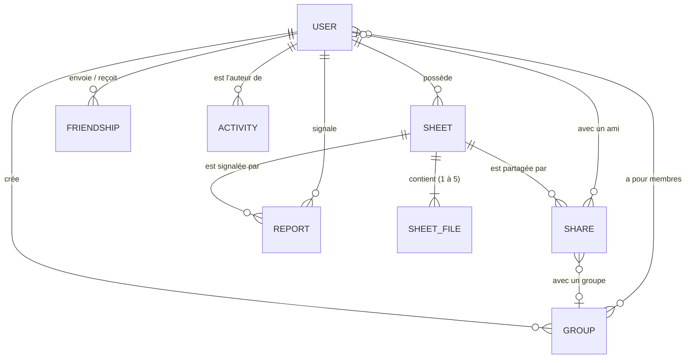
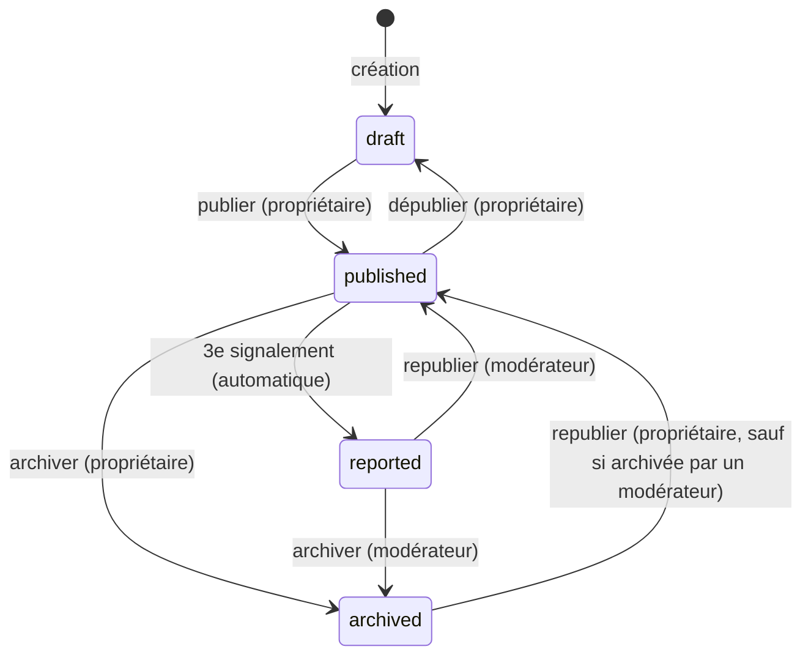

# Modèle de données

> Base : **MongoDB Atlas**, schémas définis avec **Mongoose** dans `server/src/modules/*/*.model.ts`.
> Les fichiers eux-mêmes sont dans **Supabase Storage** : MongoDB ne contient que leurs informations (nom, type, taille, chemin de stockage).
>
> État : 🔲 prévu · ✅ implémenté

## Vue d'ensemble



| Collection | Rôle | État |
|---|---|---|
| `users` | Comptes utilisateurs | 🔲 |
| `sheets` | Fiches, avec leurs fichiers (sous-documents) | 🔲 |
| `friendships` | Invitations et liens d'amitié | 🔲 |
| `groups` | Groupes de révision | 🔲 |
| `shares` | Partages d'une fiche avec un ami ou un groupe | 🔲 |
| `reports` | Signalements | 🔲 |
| `activities` | Événements du fil d'activité | 🔲 |
| `favorites` | Fiches mises en favori (bonus) | 🔲 |

Tous les documents ont `_id` (ObjectId) et, sauf mention contraire, `createdAt` et `updatedAt` (option `timestamps` de Mongoose). Dans l'API, `_id` est renvoyé sous le nom `id`.

---

## `users`

| Champ | Type | Contraintes |
|---|---|---|
| `username` | string | Requis, unique, 3 à 30 caractères, `[a-z0-9._-]` |
| `email` | string | Requis, unique, en minuscules |
| `passwordHash` | string | Requis, hash bcrypt, **jamais renvoyé** (`select: false`) |
| `role` | `'user'` \| `'moderator'` | Défaut `'user'` |
| `program` | string | Facultatif — filière (ex. « MIAGE ») |
| `level` | `Level` | Facultatif — voir les valeurs plus bas |
| `bio` | string | Facultatif, 300 caractères au maximum |
| `storageUsed` | number | Octets utilisés, défaut 0. Mis à jour avec `$inc` à chaque ajout ou suppression de fichier |

**Index :** `username` (unique), `email` (unique).

**Modérateurs :** il n'y a pas de route pour devenir modérateur. Le rôle est donné par un script (`npm run make-moderator -- <email>`) ou directement dans la base.

## `sheets`

| Champ | Type | Contraintes |
|---|---|---|
| `title` | string | Requis, 3 à 120 caractères |
| `description` | string | Facultatif, 2 000 caractères au maximum |
| `subject` | `Subject` | Requis — voir les valeurs plus bas |
| `level` | `Level` | Requis |
| `tags` | string[] | 0 à 10, chacun 2 à 30 caractères, en minuscules, sans doublon |
| `owner` | ObjectId → `users` | Requis |
| `visibility` | `'public'` \| `'private'` | Requis, défaut `'private'` |
| `status` | `'draft'` \| `'published'` \| `'reported'` \| `'archived'` | Défaut `'draft'` |
| `archivedByModerator` | boolean | Défaut `false`. Si `true`, le propriétaire ne peut pas republier |
| `files` | `SheetFile[]` | 1 à 5 éléments |
| `downloadsCount` | number | Défaut 0 |
| `publishedAt` | Date | Renseignée à chaque publication |

### Sous-document `SheetFile`

| Champ | Type | Contraintes |
|---|---|---|
| `_id` | ObjectId | Identifiant du fichier dans la fiche |
| `storageKey` | string | Chemin dans Supabase : `users/{userId}/{uuid}.{ext}` |
| `originalName` | string | Nom d'origine, nettoyé, 255 caractères au maximum |
| `mimeType` | `'application/pdf'` \| `'image/png'` \| `'image/jpeg'` | Vérifié sur le contenu réel du fichier |
| `size` | number | Octets, 20 Mo au maximum |

**Index :**
- texte : `title` (poids 10), `tags` (poids 5), `description` (poids 1), langue française ;
- `{ status: 1, visibility: 1, publishedAt: -1 }` pour les fiches récentes ;
- `{ owner: 1, status: 1, updatedAt: -1 }` pour « Mes fiches » ;
- `{ subject: 1, level: 1 }` pour les filtres.

## `friendships`

| Champ | Type | Contraintes |
|---|---|---|
| `requester` | ObjectId → `users` | Celui qui invite |
| `recipient` | ObjectId → `users` | Celui qui est invité |
| `pairKey` | string | Les deux identifiants triés et joints (`idA_idB`). Garantit **un seul lien** par paire |
| `status` | `'pending'` \| `'accepted'` \| `'declined'` | Défaut `'pending'` |
| `respondedAt` | Date | Date d'acceptation ou de refus |

**Index :** `pairKey` (unique), `{ recipient: 1, status: 1 }`, `{ requester: 1, status: 1 }`.

Retirer un ami supprime le document. Un refus le passe à `declined`, ce qui permet de réinviter plus tard (le document est alors réutilisé).

## `groups`

| Champ | Type | Contraintes |
|---|---|---|
| `name` | string | Requis, 3 à 60 caractères |
| `description` | string | Facultatif, 500 caractères au maximum |
| `owner` | ObjectId → `users` | Le créateur |
| `members` | ObjectId[] → `users` | Contient toujours le créateur, 50 membres au maximum |

**Index :** `members` (pour retrouver « mes groupes »).

## `shares`

| Champ | Type | Contraintes |
|---|---|---|
| `sheet` | ObjectId → `sheets` | Requis |
| `sharedBy` | ObjectId → `users` | Le propriétaire de la fiche |
| `targetType` | `'user'` \| `'group'` | Requis |
| `targetUser` | ObjectId → `users` | Requis si `targetType = 'user'` |
| `targetGroup` | ObjectId → `groups` | Requis si `targetType = 'group'` |
| `revokedAt` | Date \| null | `null` tant que le partage est actif |

Un partage arrêté n'est **pas supprimé** : `revokedAt` est renseigné, ce qui garde un historique.

**Index :**
- unique partiel `{ sheet, targetType, targetUser, targetGroup }` quand `revokedAt` est `null` (pas deux partages actifs identiques) ;
- `{ targetUser: 1, revokedAt: 1 }` et `{ targetGroup: 1, revokedAt: 1 }` pour « Partagées avec moi ».

## `reports`

| Champ | Type | Contraintes |
|---|---|---|
| `sheet` | ObjectId → `sheets` | Requis |
| `reporter` | ObjectId → `users` | Requis |
| `reason` | `'inappropriate'` \| `'copyright'` \| `'spam'` \| `'other'` | Requis |
| `comment` | string | Facultatif, 500 caractères au maximum |
| `status` | `'open'` \| `'accepted'` \| `'rejected'` | Défaut `'open'` |
| `resolvedBy` | ObjectId → `users` | Le modérateur |
| `resolvedAt` | Date | |

**Index :** `{ sheet, reporter }` (unique : un seul signalement par personne et par fiche), `{ status: 1, createdAt: 1 }`.

## `activities`

| Champ | Type | Contraintes |
|---|---|---|
| `actor` | ObjectId → `users` | Qui a fait l'action |
| `type` | `ActivityType` | Voir ci-dessous |
| `sheet` | ObjectId → `sheets` | Selon le type |
| `targetUser` | ObjectId → `users` | Selon le type |
| `group` | ObjectId → `groups` | Selon le type |
| `createdAt` | Date | Pas de `updatedAt` |

| `ActivityType` | Signification | Champs utilisés |
|---|---|---|
| `sheet.published` | `actor` a publié `sheet` | `sheet` |
| `friendship.accepted` | `actor` et `targetUser` sont devenus amis | `targetUser` |
| `group.member_added` | `actor` a ajouté `targetUser` au groupe `group` | `targetUser`, `group` |

**Index :** `{ actor: 1, createdAt: -1 }`, et un index TTL qui supprime les activités de plus de 90 jours.

Le fil n'affiche une activité `sheet.published` que si la fiche est **visible** par le lecteur (règle d'accès ci-dessous).

## `favorites` (bonus)

| Champ | Type | Contraintes |
|---|---|---|
| `user` | ObjectId → `users` | |
| `sheet` | ObjectId → `sheets` | |

**Index :** `{ user, sheet }` (unique).

---

## Valeurs fixes (dans `shared/src/constants/`)

| Type | Valeurs |
|---|---|
| `Level` | `L1`, `L2`, `L3`, `M1`, `M2`, `other` |
| `Subject` | `computer-science`, `mathematics`, `management`, `economics`, `law`, `languages`, `physics`, `chemistry`, `biology`, `other` (libellés français dans l'interface) |
| Types de fichier acceptés | `application/pdf`, `image/png`, `image/jpeg` |
| Taille maximale d'un fichier | 20 Mo (`MAX_FILE_SIZE_MB`) |
| Fichiers par fiche | 1 à 5 |
| Quota par utilisateur | 50 Mo (`USER_QUOTA_MB`) |
| Seuil de signalements | 3 (`REPORT_THRESHOLD`) |

---

## Cycle de vie d'une fiche



| Transition | Qui | Conditions | Effets |
|---|---|---|---|
| `draft → published` | Propriétaire | Au moins 1 fichier | `publishedAt` = maintenant ; activité `sheet.published` |
| `published → draft` | Propriétaire | — | La fiche disparaît pour les autres |
| `published → archived` | Propriétaire | — | La fiche disparaît pour les autres |
| `archived → published` | Propriétaire | `archivedByModerator = false` | `publishedAt` = maintenant |
| `published → reported` | Système | Nombre de signalements `open` ≥ `REPORT_THRESHOLD` | Masquée de la recherche ; modification bloquée |
| `reported → published` | Modérateur | — | Signalements passés à `rejected` |
| `reported → archived` | Modérateur | — | Signalements passés à `accepted` ; `archivedByModerator = true` |

Toute autre transition est refusée avec l'erreur `409 INVALID_TRANSITION`. La suppression d'une fiche est possible à tout moment par son propriétaire.

Ces règles sont codées dans `server/src/modules/sheets/sheet.state.ts` (table des transitions + `assertTransition`).

---

## Règle d'accès

C'est la règle centrale du projet. Elle est codée **à un seul endroit** : `server/src/modules/sheets/sheet.policy.ts`.

### Pour une fiche donnée : `canViewSheet(user, sheet)`

Un utilisateur peut voir une fiche si **au moins une** de ces conditions est vraie :

1. il en est le **propriétaire** (quel que soit l'état) ;
2. il est **modérateur** et la fiche est **signalée** ;
3. la fiche est **publiée** et **publique** ;
4. la fiche est **publiée** et il existe un **partage actif** (`revokedAt = null`) :
   - vers lui directement, **ou**
   - vers un **groupe dont il est membre**.

Sinon, l'API répond `404 SHEET_NOT_FOUND`, sans révéler que la fiche existe.

### Pour une liste de fiches : `buildVisibleSheetsFilter(userId)`

Pour la recherche, les fiches récentes et « Partagées avec moi », la même règle est traduite en **requête MongoDB**, utilisée partout :

```ts
// sharedSheetIds : fiches partagées avec l'utilisateur ou un de ses groupes (partages actifs)
{
  status: 'published',
  $or: [
    { visibility: 'public' },
    { owner: userId },
    { _id: { $in: sharedSheetIds } },
  ],
}
```

### Modification : `canEditSheet(user, sheet)`

Seul le **propriétaire** peut modifier, changer l'état, partager ou supprimer sa fiche. La modification est bloquée tant que la fiche est **signalée**.

### Effets en cascade

| Événement | Conséquence |
|---|---|
| Un ami est retiré | Les partages directs entre les deux utilisateurs sont arrêtés |
| Un membre quitte un groupe ou en est retiré | Il perd l'accès aux fiches partagées avec ce groupe (automatique, par la règle) |
| Un groupe est supprimé | Les partages vers ce groupe sont arrêtés |
| Une fiche est supprimée | Ses fichiers sont supprimés de Supabase ; ses partages, signalements, activités et favoris sont supprimés ; le quota du propriétaire est libéré |
